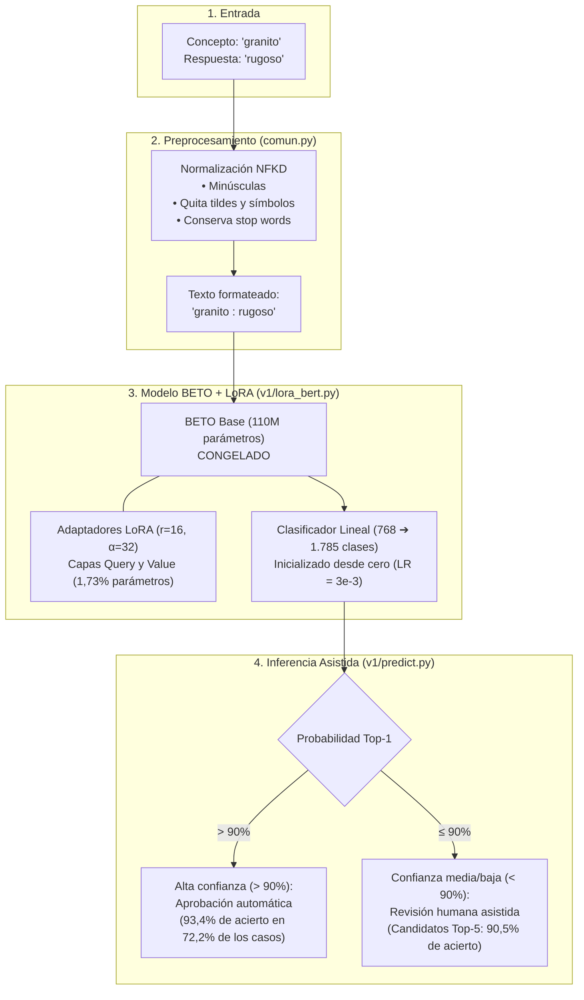

# Proyecto NLP 2026-1 — PEFT-Clasificación (Lang-Chi)

Clasificación automática de propiedades semánticas (dataset **CPN120**): dado un concepto y la
respuesta de un participante (ej. *caracol → "baboso"*), predecir el código asignado por
codificadores humanos (ej. `baboso`). Hay **1.785 códigos posibles**.

Paper de referencia: Ramos, D., Chaigneau, S., Moreno, S., Canessa, E. (2025).
*Using Chat-GPT for coding properties in semantic memory studies.*

## Estructura

```
data/CPN120.csv              datos entregados por el curso
requirements.txt             dependencias de Python
v0_cruda/
  entrenar_lora.py           versión cruda generada por IA
  PROMPTS.md                 mensajes enviados a la IA, proceso y prompt reconstruido
v1/
  comun.py                   datos, normalización, particiones 5-fold y métricas
  tfidf_svm.py               versión simplificada: TF-IDF + SVM
  lora_bert.py               versión mejorada: BETO + LoRA
  predict.py                 predicción para un concepto y una respuesta nuevos
  analisis_errores.py/.md    reporte de resultados por fold
  resultados_v1/             métricas por fold
```

## Instalación y requisitos

El proyecto utiliza Python y las dependencias indicadas en
`requirements.txt`.

Desde la carpeta principal del repositorio, ejecutar:

```powershell
python -m pip install -r requirements.txt
```

Para verificar las dependencias instaladas:

```powershell
python -m pip check
```

El entrenamiento de BETO + LoRA puede utilizar aceleración
por GPU mediante PyTorch. La configuración depende del
hardware disponible y de la compatibilidad con CUDA o ROCm.

El proyecto fue ejecutado en distintos equipos del grupo.
Los tiempos de entrenamiento según la GPU utilizada se
encuentran documentados en la sección correspondiente.

Para reproducir los experimentos se recomienda mantener
versiones compatibles de PyTorch, Transformers y PEFT.
```


## Datos

- 31.864 filas, 120 conceptos, 1.785 códigos.
- 24.094 filas distintas: ~24 % son repeticiones (varias personas dieron la misma respuesta).
- El paper reporta 27.138 propiedades para CPN120, con los mismos 1.785 códigos. Desconocemos
  el origen de la diferencia (posiblemente otra versión o limpieza del dataset).

---

## v0 — Versión cruda generada por IA

**Cómo se generó (prompt).** La v0 se generó exclusivamente mediante prompt engineering
conversacional (5 mensajes) con una IA (Claude, de Anthropic). La transcripción de los mensajes,
el proceso que siguió la IA y un prompt reconstruido a posteriori están en
[`v0_cruda/PROMPTS.md`](v0_cruda/PROMPTS.md). Se le entregó:

1. El enunciado del proyecto (PDF).
2. El archivo `CPN120.csv`.
3. Las características del PC donde se iba a entrenar (GPU GTX 1650 de 4 GB, 16 GB RAM, Windows 10).

y se le pidió ayuda para resolver el proyecto. **No se le entregó el paper de referencia**, así
que la IA no sabía cómo evalúa el paper (5-fold, top-5).

**Nota sobre "crudo".** La IA probó el script antes de entregarlo, detectó un error de
compatibilidad (el parámetro `warmup_ratio` fue eliminado en `transformers` 5) y lo corrigió.
Fuera de eso, `v0_cruda/entrenar_lora.py` es exactamente lo que entregó la IA, **sin
modificaciones del equipo**.

**Qué hace.**
- Modelo base: BETO (`dccuchile/bert-base-spanish-wwm-cased`), BERT en español.
- PEFT con **LoRA** (r = 16) en las capas `query` y `value` de la atención. Se congela BETO
  completo y solo se entrenan los adaptadores LoRA y la capa clasificadora:
  **1.962.489 de 113.186.034 parámetros (1,73 %)**.
- Una sola división aleatoria 80/10/10 (train/validación/test), 5 épocas.

**Resultados v0 (test, 3.187 ejemplos).**

| Métrica | Valor |
|---|---|
| Accuracy | 66,2 % |
| F1 macro | 0,465 |
| F1 ponderado | 0,620 |

La accuracy en validación seguía subiendo al terminar la época 5 (38 → 55 → 62 → 65 → 66 %):
el modelo quedó sub-entrenado.

**Cómo correrlo.**
```
cd v0_cruda
python entrenar_lora.py --csv ../data/CPN120.csv
```

---

## v1 — Mejoras

Uso de IA: la IA propuso cambios y el equipo decidió cuáles aplicar y por qué. Decisiones
del equipo:

- Buscar el paper de referencia y evaluar igual que los autores (5-fold, top-1 y top-5).
- Correr LoRA primero solo en el fold 0, por tiempo de cómputo en la GTX 1650, y luego
  completar los 5 folds en GPUs más potentes (RTX 4070 Super, RX 9070 XT, RTX 3060 Laptop).
- Revisar si la pérdida de entrenamiento muy baja era sobreajuste antes de aceptar el resultado.
- Comparar tiempos de entrenamiento entre GPUs.
- Corregir `predict.py` para que use el mismo modelo, la misma normalización y el mismo formato
  de entrada que el entrenamiento.

| Cambio | Por qué |
|---|---|
| Particiones 5-fold (las del paper) y métricas top-1, top-5 y F1 macro | Es como evalúa el paper; permite una comparación justa. TF-IDF y LoRA se evaluaron en los 5 folds completos (fold 0 en GTX 1650 y folds 1 al 4 en RTX 4070 Super en ~10 min con FP16). La variación entre folds fue mínima: ± 0,2 % en Top-1 para LoRA y ± 0,6 % para TF-IDF |
| Normalización del texto (minúsculas, sin tildes ni símbolos, sin quitar stop words) | Mejor preprocesamiento según los autores; reduce ruido como "Condimentos" o "tecnologíco" |
| Versión simplificada TF-IDF + SVM | El enunciado pide comparar con versiones simplificadas |
| LoRA: 10 épocas en vez de 5 | En v0 el modelo seguía mejorando al terminar |
| LoRA: tasa de aprendizaje mayor para la capa clasificadora | Esa capa parte desde cero y tiene 1.785 clases |
| LoRA: ciclo de entrenamiento propio en PyTorch, textos tokenizados una vez | Más simple de explicar que `Trainer` |

**Cómo correrlo.**
```
cd v1
python tfidf_svm.py --csv ../data/CPN120.csv
python lora_bert.py --csv ../data/CPN120.csv             # 5 folds completos
python lora_bert.py --csv ../data/CPN120.csv --folds 0   # solo fold 0
```

**Probar el modelo con una respuesta nueva** (`predict.py`). Primero hay que entrenar y guardar
el modelo de un fold; después se le pasa un concepto y una respuesta:
```
cd v1
python lora_bert.py --csv ../data/CPN120.csv --folds 0 --salida prueba_inferencia
python predict.py --concepto "granito" --respuesta "rugoso"
```
Muestra los 5 códigos más probables con su probabilidad.

### Arquitectura y Flujo del Sistema



El flujo de trabajo se divide en 4 etapas:
1. **Entrada:** Se recibe el par concepto-respuesta generado en estudios de memoria semántica (ej. *"granito"* y *"rugoso"*).
2. **Preprocesamiento (`comun.py`):** Normaliza el texto a minúsculas, descompone caracteres NFKD para eliminar acentos diacríticos y descarta signos ortográficos ruidosos, manteniendo las *stop words* (clave en expresiones breves). Concatena en formato `"concepto : respuesta"`.
3. **Adaptación Eficiente (`lora_bert.py`):** Se congela el modelo preentrenado BETO (110M parámetros) y se insertan adaptadores LoRA ($r=16$) en las capas de atención `query` y `value`. Se añade una cabeza clasificadora lineal de 1.785 clases con una tasa de aprendizaje mayor (`3e-3` vs `5e-4` en LoRA), optimizando únicamente el **1,73 % de los parámetros**.
4. **Decisión Asistida (`predict.py`):** Se obtienen las probabilidades Softmax. Si la predicción más probable supera el 90 % de confianza (72,2 % de los casos), se aprueba automáticamente con un 93,4 % de precisión. En casos ambiguos o de cola larga, se ofrecen los 5 candidatos principales (Top-5), alcanzando un 90,5 % de cobertura para revisión humana asistida.

### Explicación del código

**`comun.py`** — funciones compartidas por todos los modelos v1.
- `normalizar`: pasa a minúsculas, quita tildes y símbolos y deja solo letras, números y espacios.
  No quita stop words, porque en frases tan cortas pueden cambiar el significado (criterio del paper).
- `cargar_datos`: lee el CSV, elimina filas incompletas y arma la entrada del modelo como
  `"concepto : respuesta"` normalizada. El concepto se incluye porque una misma respuesta puede
  tener códigos distintos según el concepto.
- `particiones`: divide los datos en 5 folds con `KFold` (semilla 42). Todos los modelos usan
  exactamente las mismas particiones, así la comparación es justa.
- `metricas`: calcula top-1 (el código más probable es el correcto), top-5 (el correcto está entre
  los 5 más probables) y F1 macro (promedio del F1 de cada código, que da el mismo peso a los
  códigos raros que a los frecuentes).

**`tfidf_svm.py`** — versión simplificada.
- `TfidfVectorizer(analyzer="char_wb", ngram_range=(2, 5))`: representa cada texto por los trozos
  de 2 a 5 letras que contiene, ponderados por TF-IDF (más peso a los trozos frecuentes en ese
  texto y raros en el resto). Al trabajar con letras y no con palabras completas, tolera faltas de
  ortografía ("responsbailidad") y variaciones ("miedoso" / "miedo").
- `LinearSVC`: un clasificador lineal (una frontera por cada código). `decision_function` entrega
  un puntaje por código, que se usa para el top-5.

**`lora_bert.py`** — versión con PEFT.
1. *Tokenización:* convierte todos los textos en números (tokens de BETO) una sola vez al inicio.
2. *Modelo:* carga BETO con una capa clasificadora nueva de 1.785 salidas y le aplica LoRA
   (`r=16`, capas `query` y `value` de la atención). BETO queda congelado y solo se entrenan los
   adaptadores LoRA y la capa clasificadora (1,73 % de los parámetros).
3. *Optimizador:* AdamW con dos tasas de aprendizaje, 5e-4 para LoRA y 3e-3 para la capa
   clasificadora, que parte desde cero. La tasa sube durante el 6 % inicial de los pasos (warmup)
   y después baja linealmente.
4. *Entrenamiento:* 10 épocas en lotes de 64, con FP16 en GPU (`autocast` y `GradScaler`) para
   usar menos memoria y entrenar más rápido.
5. *Evaluación:* calcula las probabilidades de cada código para el fold de test y obtiene las
   métricas de `comun.py`.
6. *Guardado:* guarda las métricas, las probabilidades de cada fold y el modelo entrenado
   (`checkpoint_fold_N`), que usa `predict.py`.

**`predict.py`** — carga BETO, le aplica el adaptador LoRA guardado, normaliza el concepto y la
respuesta igual que en el entrenamiento y muestra los códigos más probables.

---

## Comparación con el paper (CPN120, accuracy en test)

| Sistema | Evaluación | Top-1 | Top-5 |
|---|---|---|---|
| AC-PLT (paper, leído de la Figura 4) | 5-fold | ~54 % | ~62 % |
| GPT-3.5 fine-tuning (paper) | 5-fold | 58,2 % | — |
| GPT-4o one-shot (paper) | 5-fold | 17,8 % | — |
| GPT-3.5 one-shot (paper) | 5-fold | 7,3 % | — |
| **v0: BETO + LoRA** | 1 división 80/10/10 | 66,2 % | — |
| **v1: TF-IDF + SVM** | 5-fold (promedio) | 76,4 % ± 0,6 | 87,0 % |
| **v1: TF-IDF + SVM** | solo fold 0 | 76,1 % | 86,8 % |
| **v1: BETO + LoRA** | **5-fold (promedio)** | **79,2 % ± 0,2** | **90,5 % ± 0,5** |
| **v1: BETO + LoRA** | solo fold 0 | 79,3 % | 90,1 % |

Resultados de LoRA v1 por fold (`v1/resultados_v1/lora_5folds_completo.csv`):
- Fold 0: 79,3 % Top-1 | 90,1 % Top-5 | F1 macro 0,660
- Fold 1: 79,2 % Top-1 | 90,4 % Top-5 | F1 macro 0,645
- Fold 2: 79,2 % Top-1 | 90,7 % Top-5 | F1 macro 0,650
- Fold 3: 79,2 % Top-1 | 91,2 % Top-5 | F1 macro 0,652
- Fold 4: 78,9 % Top-1 | 90,0 % Top-5 | F1 macro 0,635
- **Promedio ± std:** **79,2 % ± 0,2** (Top-1) | **90,5 % ± 0,5** (Top-5) | **0,649 ± 0,009** (F1 macro)

F1 macro en 5-fold: TF-IDF 0,608 ± 0,014 vs. LoRA v1 **0,649 ± 0,009**, confirmando que LoRA clasifica mejor los códigos poco frecuentes en todas las particiones.

**Sobre el sobreajuste.** La pérdida de entrenamiento de LoRA v1 bajó hasta 0,13 en la época 10,
lo que hacía sospechar memorización (el paper reporta algo así con GPT-3.5 en CPN27: 91 % en
train vs. 67 % en test). Sin embargo, en test LoRA v1 promedia 79,2 % en los 5 folds, superando consistentemente a la v0 y a
TF-IDF: la pérdida baja se explica en buena parte por las respuestas repetidas del dataset.

Tiempos de entrenamiento:
- Fold 0 en GTX 1650 (4 GB): ~13 min por época (~2 h 15 min total).
- Folds 1 al 4 en RTX 4070 Super (12 GB, FP16): ~15–18 s por época (~2,5 min por fold, ~10 min en total).
- Folds 0 al 4 en RX 9070 XT (16 GB, RDNA 4, ROCm 10.2 en Windows): ~7–8 s por época (~1 min 15 s por fold, ~6 min 15 s los 5 folds completos).
- Folds 0 al 4 en RTX 3060 Laptop (6 GB): ~30–39 s por época (~5–6 min por fold) (~30 min en total).

El fine-tuning de GPT-3.5 del paper costó US$87,77. Nuestros modelos corren localmente y gratis
en hardware de consumo.

---

## Limitaciones

Calculadas con las predicciones de LoRA v1 y TF-IDF en el fold 0 (6.373 ejemplos de test):

| Situación | LoRA v1 | TF-IDF |
|---|---|---|
| La misma respuesta (concepto + respuesta) ya aparecía en entrenamiento (45 % del test) | 96,4 % | 95,7 % |
| Respuesta nueva, no vista en entrenamiento (55 %) | **65,3 %** | 60,1 % |
| Código con 100 o más ejemplos de entrenamiento | 92,6 % | 90,1 % |
| Código con 1 a 4 ejemplos de entrenamiento | 56,1 % | 52,6 % |
| Código que no aparece en entrenamiento (82 casos, 1,3 %) | 0 % | 0 % |

*Nota sobre las corridas:* Esta tabla fue calculada sobre las predicciones de la primera ejecución del Fold 0 (65,3 % en respuestas nuevas). En el reporte complementario ([`v1/analisis_errores.md`](v1/analisis_errores.md)) se utilizan las predicciones de una segunda corrida completa independiente de los 5 folds ([`v1/resultados_v1/lora_5folds_corrida2_rx9070xt.csv`](v1/resultados_v1/lora_5folds_corrida2_rx9070xt.csv)), donde el Fold 0 obtuvo 64,8 % en respuestas nuevas y un top-1 global de 79,1 % (vs. 79,2 % oficial). Ambos resultados son consistentes dentro de un margen de ± 0,5 %.

- **Las respuestas repetidas inflan la accuracy global.** Cerca del 24 % de las filas del dataset
  son repeticiones, y al dividir al azar la misma respuesta queda en entrenamiento y en test. Con
  respuestas nuevas, LoRA acierta 65 %, y es ahí donde más supera a TF-IDF.
- **Cola larga.** El 54 % de los códigos aparece menos de 10 veces en el dataset, y la accuracy
  baja mucho para esos códigos. Un código que no aparece en entrenamiento nunca se puede predecir.
- **Los errores suelen ser casi sinónimos**, por ejemplo `temor` → `miedo`, `conjunto` → `grupo`,
  `frutas` → `verduras` o `astucia` → `valentia`.
- **La confianza del modelo es útil.** Cuando la probabilidad del código predicho supera el 90 %
  (72 % de los casos), acierta el 93,9 %; cuando es menor al 50 %, acierta alrededor del 22 %. Esto
  permite una codificación asistida: aceptar las predicciones seguras y enviar las dudosas a
  revisión humana.
- **Comparación con el paper.** Nuestro CSV tiene 31.864 filas y el paper reporta 27.138 para
  CPN120 (con los mismos 1.785 códigos), así que la comparación de cifras es aproximada.

